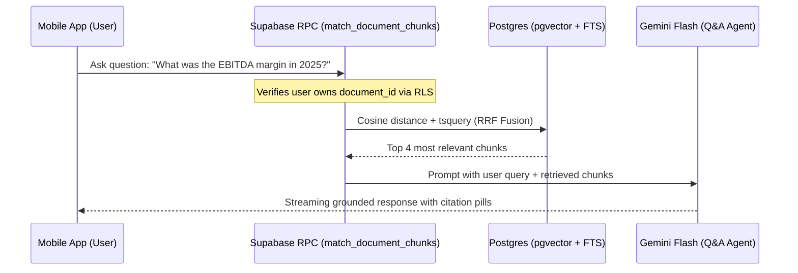

# Adding a Stage to the Zukai Pipeline

**Document Version:** 1.0.0  
**Scope:** Guide for extending the sequential agentic pipeline with new capabilities (e.g., Quiz Generator, Interactive Flashcards, Two-Host Podcast, or "Ask Your Document" Q&A).

---

## 1. Overview

The Zukai Pipeline V2 is structured as an extensible pipeline defined as data. Every stage conforms to the `IStage<TInput, TOutput>` interface:

```typescript
export interface IStage<TInput = any, TOutput = any> {
  readonly name: PipelineStageName;
  readonly version: string;
  readonly progressRange: [number, number];
  readonly inputSchema: z.ZodType<any, any, any>;
  readonly outputSchema: z.ZodType<any, any, any>;

  run(ctx: StageContext, input: TInput): Promise<TOutput>;
  validate(output: TOutput): Promise<boolean>;
}
```

Because the `DurableOrchestrator` relies exclusively on this interface and persists state via `job_artifacts` in Postgres, new stages can be integrated without modifying orchestrator control flow.

---

## 2. Step-by-Step: Adding a New Stage (e.g. `quiz_generation`)

### Step 1: Define Schemas & Stage Contract
In `worker/src/pipelines/types.ts`:
1. Add stage name to `PipelineStageNames`:
   ```typescript
   export const PipelineStageNames = [
     'reading',
     'understanding',
     'writing',
     'recording',
     'final_touches',
     'quiz_generation', // New stage
   ] as const;
   ```
2. Define Zod input and output schemas:
   ```typescript
   export const QuizItemSchema = z.object({
     question: z.string(),
     options: z.array(z.string()).length(4),
     correctIndex: z.number().min(0).max(3),
     explanation: z.string(),
     sourceChunkId: z.string(),
   });

   export const QuizStageOutputSchema = z.object({
     quizzes: z.array(QuizItemSchema),
   });
   ```

### Step 2: Implement the Stage Class
Create `worker/src/pipeline/quiz/quizStage.ts`:
```typescript
import { IStage, StageContext, QuizStageOutput, QuizStageOutputSchema } from '../types.js';

export class QuizStage implements IStage<WritingStageOutput, QuizStageOutput> {
  readonly name = 'quiz_generation' as const;
  readonly version = '1.0.0';
  readonly progressRange: [number, number] = [95, 100];
  readonly inputSchema = WritingStageOutputSchema;
  readonly outputSchema = QuizStageOutputSchema;

  async run(ctx: StageContext, input: WritingStageOutput): Promise<QuizStageOutput> {
    ctx.logger.info({ jobId: ctx.jobId }, 'Generating quiz questions grounded in verified script');

    // 1. Check cached artifact for resume
    const cached = await ctx.getArtifact<QuizStageOutput>('quiz_output');
    if (cached) return cached;

    // 2. Invoke LLM via executeWithFallback('script', ...)
    // ...

    // 3. Save artifact
    await ctx.saveArtifact('quiz_output', result);
    return result;
  }

  async validate(output: QuizStageOutput): Promise<boolean> {
    return this.outputSchema.safeParse(output).success && output.quizzes.length >= 3;
  }
}
```

### Step 3: Register in Pipeline Registry
In `worker/src/pipelines/registry.ts` or a new pipeline definition (e.g. `podcast-interactive.v1.ts`):
```typescript
export const InteractiveAudioPipeline: PipelineDefinition = {
  name: 'interactive-audio',
  version: 'v1',
  description: '5-Stage Audio + Interactive Quiz',
  stages: [
    new ReadingStage(),
    new UnderstandingStage(),
    new WritingStage(),
    new RecordingStage(),
    new FinalTouchesStage(),
    new QuizStage(),
  ],
};
```

---

## 3. How "Ask Your Document" (Q&A) Reuses the RAG Store

The `document_chunks` table and `match_document_chunks` RPC created in Migration 21 directly power the future interactive Q&A feature without requiring separate ingestion:



### Key Architectural Benefits:
1. **Zero Duplicate Ingestion:** The document is already extracted, sectioned, chunked, and embedded during the initial audio generation.
2. **Strict Multi-Tenant Isolation:** The RPC validates `owner_id = auth.uid() or private.is_org_member(org_id)`. Users can never query chunks belonging to other tenants.
3. **Instant Latency:** Retrieval occurs in $< 20$ ms directly within Postgres HNSW index.
