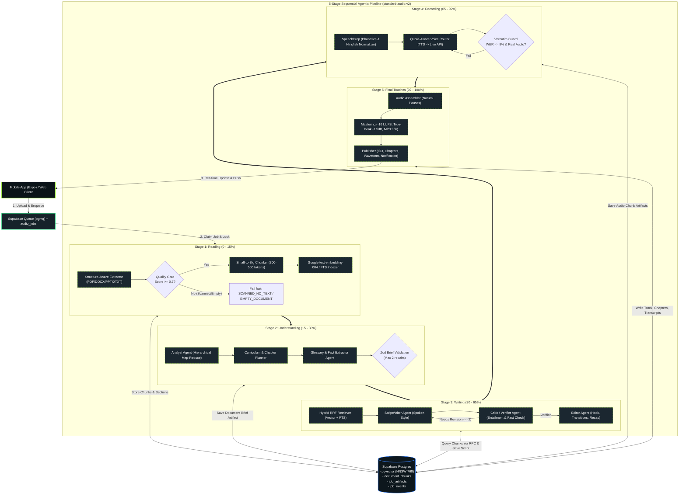
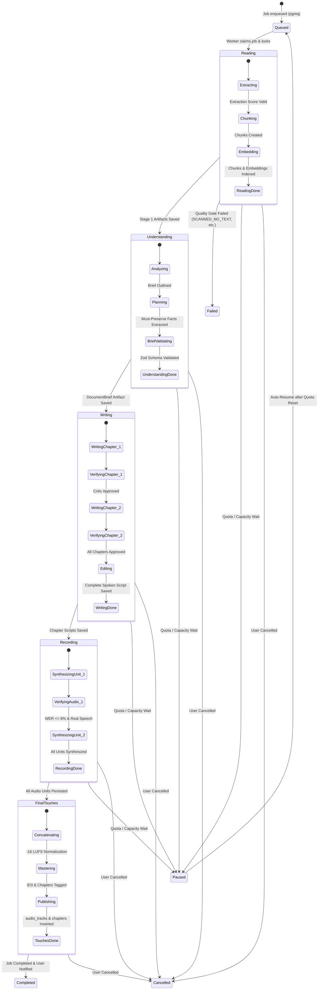

# Zukai Document-to-Audio Pipeline Architecture (v2)

**Document Version:** 2.0.0  
**Status:** Approved Architecture Specification  
**Scope:** 5-Stage Durable Sequential Agentic Pipeline with Hybrid RAG, Multi-Tenant Isolation, and Resumable Postgres State Machine.

---

## 1. Executive Summary

Zukai v2 re-architects the document-to-audio engine from a linear script pipeline into an **enterprise-grade, sequential agentic orchestration with hybrid RAG**. The system processes complex enterprise and educational documents (PDF, DOCX, PPTX, TXT) into studio-mastered spoken audio in English and Hinglish.

### Key Architectural Principles
1. **Deterministic Sequential Order:** 5 stages execute in strict sequence matching the mobile UI: `Reading` (0-15%) $\rightarrow$ `Understanding` (15-30%) $\rightarrow$ `Writing` (30-65%) $\rightarrow$ `Recording` (65-92%) $\rightarrow$ `Final Touches` (92-100%).
2. **Bounded Agentic Loops:** LLM agents act within role-specific boundaries with validated Zod schemas, deterministic tool sandboxes, and capped revision loops ($\le 2$ repair attempts). No autonomous free-roaming agents.
3. **Durable Postgres State Machine:** Every stage and unit execution is persisted in Postgres (`audio_jobs`, `job_artifacts`, `job_events`). State survives worker restarts, pod crashes, and quota pauses with zero duplicate token or audio spend.
4. **Hybrid RAG Store (pgvector + FTS):** High-recall document chunking (300-500 tokens with small-to-big context expansion) with Google `text-embedding-004` (768 dimensions), HNSW cosine index, PostgreSQL full-text search (`tsvector`), and Reciprocal Rank Fusion (RRF).
5. **Multi-Tenant Isolation & Zero-Leakage:** Row Level Security (RLS) on all chunk and event tables. Service-role-only writes. Strict sanitization of user-facing errors (`error_code` only). No document text, transcripts, tokens, or signed URLs in logs.

---

## 2. High-Level System Architecture



---

## 3. Durable Postgres State Machine



---

## 4. Stage & Agent Interface Design

Each stage and agent conforms to strongly-typed contracts defined in TypeScript and validated with **Zod**.

### 4.1 Stage Contract (`IStage`)
```typescript
export interface StageContext {
  jobId: string;
  documentId: string;
  ownerId: string;
  orgId?: string;
  language: 'en' | 'hi' | 'hinglish';
  depth: 'quick' | 'standard' | 'deep';
  voiceId: string;
  pipelineVersion: string;
  promptVersion: string;
  signal: AbortSignal;
  supabase: SupabaseClient;
  logger: StageLogger;
  updateProgress: (percent: number, stepDetail?: string) => Promise<void>;
  recordEvent: (event: Omit<JobEventInsert, 'job_id'>) => Promise<void>;
  getArtifact: <T>(name: string) => Promise<T | null>;
  saveArtifact: <T>(name: string, data: T, metadata?: Record<string, unknown>) => Promise<void>;
}

export interface IStage<TInput, TOutput> {
  readonly name: 'reading' | 'understanding' | 'writing' | 'recording' | 'final_touches';
  readonly version: string;
  readonly progressRange: [number, number]; // e.g. [0, 15] for reading
  readonly inputSchema: z.ZodType<TInput>;
  readonly outputSchema: z.ZodType<TOutput>;

  run(ctx: StageContext, input: TInput): Promise<TOutput>;
  validate(output: TOutput): Promise<boolean>;
}
```

### 4.2 Agent Contract (`IAgent`)
```typescript
export interface AgentBudget {
  maxRequests: number;
  maxTokens: number;
  maxCostUsd: number;
  timeoutMs: number;
}

export interface IAgent<TTaskInput, TTaskResult> {
  readonly role: string;
  readonly modelTask: 'outline' | 'script' | 'voice' | 'embedding';
  readonly budget: AgentBudget;
  readonly inputSchema: z.ZodType<TTaskInput>;
  readonly outputSchema: z.ZodType<TTaskResult>;

  execute(ctx: StageContext, input: TTaskInput): Promise<TTaskResult>;
}
```

---

## 5. Stage Specifications

### Stage 1: READING (0 - 15%)
- **Objective:** Extract document content structure-aware, sanitize raw characters, partition into coherent semantic chunks, and build the hybrid search index.
- **Components:**
  1. `StructureAwareExtractor`: Specialised parsers for PDF (pdf-parse + layout heuristics for headers/footers/columns), DOCX (mammoth with headings & tables), PPTX, and TXT.
  2. `QualityGate`: Computes text density, garbage ratio, and language confidence. Returns typed errors: `SCANNED_NO_TEXT`, `EMPTY_DOCUMENT`, `PASSWORD_PROTECTED`, `UNSUPPORTED_FILE`.
  3. `SmallToBigChunker`: Chunks text into 300-500 token segments with 10-15% overlap. Links each chunk to its parent `document_sections` for hierarchical context expansion.
  4. `HybridIndexer`: Embeds chunks using Google `text-embedding-004` (768 dimensions), writes vector embeddings to pgvector, and indexes textual content in PostgreSQL `tsvector` (`tsv`).
  5. `AdaptiveMode`: If document $< 4,000$ tokens, enables direct long-context processing while retaining lexical search, bypassing embedding API calls to save quota.

### Stage 2: UNDERSTANDING (15 - 30%)
- **Objective:** Deeply synthesize document concepts, identify must-preserve facts, resolve technical terms, and construct a structured spoken chapter plan.
- **Agents:**
  1. `AnalystAgent`: Map-reduces large documents across sections; summarizes core arguments and intended audience.
  2. `CurriculumPlanner`: Divides narrative into 3 to 8 logical audio chapters respecting target spoken duration and selected depth mode (`quick`: 5-7 min, `standard`: 12-18 min, `deep`: 25-40 min).
  3. `GlossaryBuilder`: Extracts technical or foreign terms; provides phonetically friendly pronunciations and contextual definitions.
  4. `FactExtractor`: Catalogs strict figures, dates, formulas, and named entities linked to `source_chunk_ids`.
- **Output:** Validated `DocumentBrief` JSON stored as a durable job artifact.

### Stage 3: WRITING (30 - 65%)
- **Objective:** Generate broadcast-quality, natural spoken script segments grounded exclusively in source document evidence.
- **Workflow:**
  1. `HybridRetriever`: Calls PostgreSQL RPC `match_document_chunks` using Reciprocal Rank Fusion (RRF) between cosine distance and full-text search.
  2. `ScriptWriter`: Drafts chapter scripts conforming to `EXPLANATION_STYLE_GUIDE.md` and `HINGLISH_STYLE.md`. Output is structured segments (`hook`, `explain`, `example`, `recap`) with internal `supports: string[]` chunk IDs.
  3. `CriticVerifier`:
     - Checks claim entailment against supporting chunks.
     - Performs deterministic regex check ensuring every number, date, and proper noun exists in source chunks.
     - Enforces max 2 revise loops per chapter. If claim fails twice, removes or softens the claim.
  4. `Editor`: Generates whole-track overture hook, seamless chapter bridges, and final synthesis recap.

### Stage 4: RECORDING (65 - 92%)
- **Objective:** Convert verified spoken text into high-fidelity, studio-grade speech.
- **Workflow:**
  1. `SpeechPrep`: Normalizes numbers, currency (lakh/crore), acronyms, symbols, and applies Hinglish phonetic transformations. Transcript retains clean Romanized text; TTS input uses phonetically tuned text.
  2. `VoiceRouter`: Dispatches synthesis to Gemini TTS (`gemini-2.5-flash-preview-tts` / `gemini-3.1-flash-tts-preview`) with fallback to Gemini Live Audio WebSocket API (`gemini-3.8-live`).
  3. `VerbatimGuard`: Validates generated audio using word-error-rate (WER $\le 8\%$) against source text, verifies sample rate, and rejects synthetic placeholder tones or clipped audio.
  4. `Idempotent Units`: Each speech chunk is persisted as an artifact before moving to the next.

### Stage 5: FINAL TOUCHES (92 - 100%)
- **Objective:** Master audio tracks to broadcast standards, compute synchronised timeline metadata, and publish production assets.
- **Workflow:**
  1. `AudioAssembler`: Concatenates chunk audio with natural cadence pauses (350ms between sentences, 800ms between chapters).
  2. `MasteringEngine`: ffmpeg EBU R128 loudness normalization (-16 LUFS $\pm 0.5$, True Peak -1.5 dBFS), mono CBR 96 kbps MP3 encoding with `libmp3lame`.
  3. `MetadataTagger`: Embeds ID3v2 tags (Title, Artist, Album, Cover Art) and ID3 chapter markers (`CHAP` / `CTOC`).
  4. `Publisher`: Computes duration via `ffprobe`, sentence-level transcript timings, 100-point normalized waveform peaks, inserts records into `audio_tracks`, `chapters`, and `transcripts`, and notifies client via Supabase Realtime.

---

## 6. Progress & State Mapping

| Stage Name | Progress Range | App Stage Checklist | Step Detail Example |
| :--- | :--- | :--- | :--- |
| **Reading** | 0% - 15% | Reading | "Extracting structure & indexing chunks" |
| **Understanding** | 15% - 30% | Understanding | "Analyzing key concepts & drafting curriculum" |
| **Writing** | 30% - 65% | Writing | "Writing chapter 3 of 6 (Grounded verification)" |
| **Recording** | 65% - 92% | Recording | "Synthesizing audio segment 12 of 34" |
| **Final Touches** | 92% - 100% | Final Touches | "Mastering audio (-16 LUFS) & tagging chapters" |

---

## 7. Multi-Tenant Security & Isolation

1. **PostgreSQL Row Level Security (RLS):**
   - `document_chunks` and `document_sections`: SELECT granted only to `auth.uid() = owner_id` or verified organization members. INSERT/UPDATE/DELETE restricted to `service_role`.
   - `job_events`: SELECT and INSERT restricted to `service_role`. Zero client exposure.
2. **Tenant-Safe Hybrid Retrieval:**
   - RPC `match_document_chunks` forces `document_id` validation against the user's active organization/ownership in the database query.
3. **Redaction & Leak Elimination:**
   - Worker never writes system paths, stack traces, raw prompts, or tokens to `audio_jobs.error_message`.
   - Client displays friendly localized errors via `error_code` with copyable support reference (`Ref: <JOB_ID[:8]>`).
